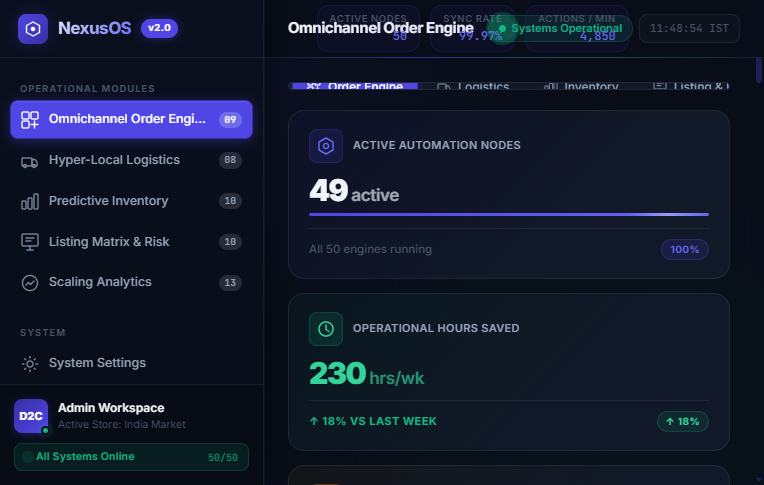
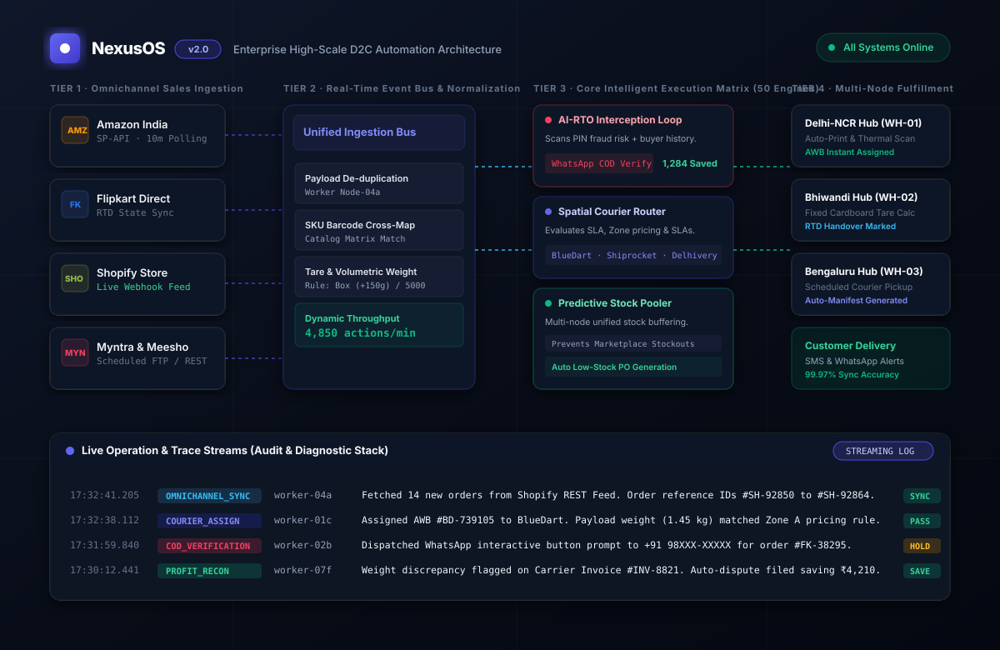

# ⚡ NexusOS

## Enterprise D2C E-Commerce Automation Operating System

A minimal, high-velocity automation operating system inspired by Linear and Vercel. Unifying omnichannel order fulfillment, spatial courier routing, multi-node inventory pooling, and AI-driven RTO fraud prevention.

[](LICENSE)
[](#)
[](#)

---

## 📌 Project Overview

**NexusOS** automates high-volume D2C e-commerce operations across **Amazon India (SP-API)**, **Flipkart Direct**, **Shopify**, **Myntra**, and **Meesho**.

It eliminates the three most critical points of margin loss for scaling brands:

1. **Overselling Penalties**: Bi-directional live inventory sync prevents stockouts across multiple marketplace channels.
2. **COD Return-To-Origin (RTO)**: AI-powered buyer risk scoring intercepts fraudulent orders via automated WhatsApp verification before labels are generated.
3. **Logistics Inefficiency**: Real-time volumetric tare calculation and geo-spatial rules route shipments to the most cost-effective carrier (BlueDart, Delhivery, Shiprocket).

---

## 📸 Dashboard & Architecture

### Live Operations Command Center



### High-Level System Architecture



---

## ⚡ Quick Start

NexusOS is built with zero external dependencies and runs in any modern web browser.

```bash
# 1. Clone or navigate to the directory
cd "Ai applicant system"

# 2. Launch local preview server (Python)
python -m http.server 8000

# Or using Node.js
npx serve . -p 8000
```

Open `http://localhost:8000` in your browser.

---

## 🔄 How It Works (Event Pipeline)

1. **Ingest**: Webhooks (Shopify) and scheduled SP-API polling (Amazon/Flipkart) stream orders into a unified event bus.
2. **Score**: AI evaluates buyer risk on COD orders. High-risk orders trigger an interactive WhatsApp verification loop.
3. **Route**: Orders are assigned to the nearest physical warehouse node (Delhi-NCR, Bhiwandi, Bengaluru) with available stock.
4. **Allocate**: Volumetric weight (+150g box tare) is calculated and matched against carrier rate cards to generate instantaneous AWBs.
5. **Reconcile**: Real-time trace logs audit courier weight invoices and marketplace penalties to automatically claim dispute reimbursements.

---

## ⚙️ 50 Structural Automation Engines

### 1. Omnichannel Order Engine (9 Engines)

Auto-Fetch Orders (10–15m), Auto-Detect RTD Status, Marketplace Status Sync, Smart Warehouse Routing, Bulk Status Batching, Regional Courier Auto-Assignment, Instant AWB Generation, Manifest Creation, Real-Time Customer Alerts.

### 2. Logistics & Multi-Warehouse (8 Engines)

Thermal Label Printing, Courier Pickup Scheduling, Packaging Tare Weight Offset, PIN-Zone Slot Scheduling, Multi-Account Carrier Splits, Warehouse Isolation Rules, Address Mapping, Channel-to-Carrier Locks.

### 3. Predictive Inventory (10 Engines)

Multi-Channel Stock Ledger, In/Out Stock Sync, Delivery Mismatch Detector, Physical Audit Reminders, Low-Stock PO Triggers, Stock Reservations, Lead-Time Profiling, PO Auto-Dispatch, Reorder PO Cloning, Smart Multi-Hub Pooling.

### 4. Listing & Risk Mitigation (10 Engines)

Listing Auto-Pull, SKU/Barcode Cross-Mapping, Live Price Synchronization, Deactivated Listing Alerts, Myntra Campaign Uploads, High-Risk COD Toggling, Instant Migration Bridge, Custom Webhook Support, AI Pre-Fulfillment RTO Scoring, Interactive WhatsApp COD Verification.

### 5. Scaling Analytics & Reconciliation (13 Engines)

Real-Time Net Margin Ledger, Payment Gateway Settlement Audit, Courier Weight Dispute Automation, GST Filing Reports, SKU Velocity Indexing, Markdown Forecaster, Clearance Automator, LTV/CAC Matrix, Root-Cause Cluster Analysis, Unified Multi-Channel Stream, Penalty SLA Auditor, Dynamic Re-Balancing, Review Sentiment Extractor.

---

## 🐙 Git Repository Push Instructions

```bash
git init
git add .
git commit -m "feat: initial commit of NexusOS Enterprise Automation OS"
git branch -M main
git remote add origin https://github.com/NS-Vandana/NexusOS-E-Commerce-Enterprise-Dashboard-Automation-.git
git push -u origin main
```

---

## 🛡 License

Distributed under the [MIT License](LICENSE).
